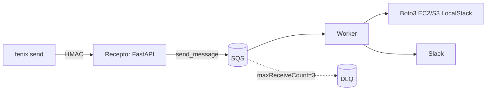

# Proyecto Fénix · Programación para Automatización II

Webhook autenticado (HMAC) -> SQS (+ DLQ) -> worker -> Boto3 (EC2/S3 en
LocalStack) -> aviso a Slack.

## 1. Objetivo del sistema

Fénix recibe alertas firmadas por webhook sobre recursos del laboratorio (una
instancia EC2 detenida o un bucket S3 sin sus etiquetas), las encola en SQS y
un worker las procesa: repara el recurso con Boto3 sobre LocalStack, verifica
el estado real por API y avisa el resultado por Slack. El receptor nunca
repara: solo autentica, valida y encola.

## 2. Integrantes y roles

| Rol | Apellido y nombre | Correo | Módulos | Pruebas |
|-----|-------------------|--------|---------|---------|
| I1  |                   |        | errors, validation, events | F06 F07 |
| I2  |                   |        | sqs, demo | F01 F08 F10 F13 |
| I3  |                   |        | crypto, receiver, repair | F02-F05 F09 |
| I4  |                   |        | logging_json, notifications | F14 F16 |
| I5  | Cerrano, Diego    | diegocerranoarg@gmail.com | worker, handle, cli, tests | F11 F12 F15 |

Somos cinco integrantes: las pruebas del rol 6 se repartieron entre todos.

## 3. Prerrequisitos y versiones

- Python 3.11 o superior (la misma versión para todo el grupo).
- Docker Desktop.
- LocalStack 3.8 (se levanta con `compose.yaml`; servicios `sqs`, `s3`, `ec2`).
- Una app de Slack con un webhook entrante (solo para `NOTIFY_PROVIDER=slack`).

Las versiones exactas de las dependencias están en `requirements-lock.txt`.

## 4. Instalación desde cero

```bash
git clone https://github.com/DiegoCerrano/fenix-ppa2.git
cd fenix-ppa2
python3 -m venv .venv
source .venv/bin/activate
python -m pip install -e ".[dev]"
cp .env.example .env          # completar WEBHOOK_SECRET (y Slack si corresponde)
docker compose up -d
python scripts/check_stack.py --tests
python -m fenix.cli init-queues
python -m fenix.cli setup-demo
```

Para generar un secreto para el webhook:

```bash
python -c "import secrets; print(secrets.token_hex(32))"
```

## 5. Variables de entorno (sin valores privados)

| Variable | Para qué sirve |
|----------|----------------|
| `AWS_ACCESS_KEY_ID` / `AWS_SECRET_ACCESS_KEY` | Credenciales ficticias de LocalStack (`test`). Una clave real (AKIA/ASIA) se rechaza. |
| `AWS_DEFAULT_REGION` | Región de los clientes Boto3 (`us-east-1`). |
| `AWS_ENDPOINT_URL` | Endpoint de LocalStack. Tiene que ser loopback y puerto 4566. |
| `LOCALSTACK_AUTH_TOKEN` | Opcional; vacío para la edición gratuita. |
| `GROUP_ID` | Identificador del grupo: va en nombres y etiquetas (`[a-z0-9-]`, 3 a 32). |
| `WEBHOOK_SECRET` | Secreto compartido de la firma HMAC (mínimo 16 caracteres). |
| `WEBHOOK_URL` | Dónde envía `fenix send` (`http://127.0.0.1:8000/webhook`). |
| `NOTIFY_PROVIDER` | `console` (desarrollo) o `slack` (entrega). |
| `SLACK_WEBHOOK_URL` | URL del webhook entrante de Slack. **Es un secreto.** |
| `FENIX_LOG_LEVEL` | Nivel de log (`DEBUG`, `INFO`…). |
| `FENIX_LOG_MAX_BYTES` | Tamaño que dispara la rotación de logs (por defecto 1000000). |

## 6. Arquitectura



| Módulo | Responsabilidad |
|--------|-----------------|
| `config/settings.py` | Lee y valida el entorno (solo biblioteca estándar). |
| `config/aws.py` | Construye los clientes Boto3 hacia LocalStack. |
| `utils/` | Errores del dominio, validadores, escritura atómica de JSON, logs JSON, firma HMAC. |
| `services/events.py` | Contrato del evento. |
| `services/receiver.py` | Receptor HTTP: tamaño, firma, JSON, contrato y recién entonces SQS. |
| `services/sqs.py` | Colas, DLQ, ACK y backoff. |
| `services/worker.py` | Consumidor: valida otra vez, llama a `handle` y confirma solo al final. |
| `services/remediation.py` | Reparación convergente y pipeline por etapas con ledger. |
| `services/notifications.py` | Avisos por consola o Slack. |
| `services/demo.py` | Laboratorio: crea, rompe y limpia los recursos. |
| `cli.py` | Interfaz de comandos. |

Decisiones de diseño: ver `docs/decisiones.md`.

## 7. Contratos de entrada y salida

Evento (exactamente estas seis claves):

```json
{
    "schema_version": 1,
    "event_id": "evt-node-001",
    "event_type": "instance.stopped",
    "resource_id": "node-01",
    "occurred_at": "2026-11-10T18:00:00Z",
    "simulate_failures": 0
}
```

- `event_type`: `instance.stopped` (para `node-01`) o `bucket.tags_missing` (para `bucket-01`).
- `resource_id`: un alias del inventario, nunca un ID de AWS.
- `occurred_at`: ISO-8601 con UTC explícito (`Z`).
- `simulate_failures`: entero de 0 a 5 (no booleano).

Firma: cabecera `t=<epoch>,v1=<64 hex>`, HMAC-SHA256 de `t.` + cuerpo crudo,
ventana de 300 s.

| Código | Cuándo |
|--------|--------|
| 202 | Evento válido y publicado en SQS (`event_id`, `message_id`). |
| 400 | El cuerpo no es JSON. |
| 401 | Firma ausente, mal formada, vieja o que no coincide (respuesta genérica). |
| 413 | Cuerpo mayor a 16 KiB. |
| 422 | JSON válido que no cumple el contrato. |
| 503 | SQS no disponible: nunca se responde un 202 falso. |

## 8. Ejecución por terminal

```bash
# Terminal 1: receptor
python -m uvicorn fenix.services.receiver:app --host 127.0.0.1 \
    --port 8000 --workers 1 --env-file .env

# Terminal 2: worker
python -m fenix.cli worker

# Terminal 3: comandos
python -m fenix.cli status
python -m fenix.cli fault node-01
python -m fenix.cli send examples/node-event.json
python -m fenix.cli dlq
```

Comandos de la CLI: `init-queues`, `setup-demo`, `status`, `fault <alias>`,
`send <archivo> [--event-id] [--failures] [--no-sig|--bad-sig|--old|--tamper]`,
`worker [--once]`, `inject-raw <texto>`, `dlq`, `cleanup [--queues]`.

## 9. Reintentos y DLQ

- Recepción con long polling de 10 s y `VisibilityTimeout=45`.
- Ante una falla transitoria no se reenvía el mensaje: se cambia su
  visibilidad a `min(30, 2**recepción)` segundos (2, 4, 8), respetando un
  `Retry-After` si lo hubo. Así el contador de recepciones sigue creciendo.
- `maxReceiveCount=3`: al tercer intento sin ACK, SQS deriva el mensaje a la DLQ.
- `fenix dlq` lee la DLQ sin borrar ni ocultar el mensaje (evidencia).

## 10. Idempotencia

- Ledger en `data/events.json`: por evento guarda `attempts`, `repair_done`,
  `repair_result`, `notified`, `status` y la huella del contenido. Cada etapa
  se guarda antes de pasar a la siguiente (escritura atómica).
- Evento ya completado: el worker solo confirma, no repara ni avisa de nuevo.
- Mismo `event_id` con otro contenido: `ConflictError`, el primer registro no
  se toca.
- Reparación convergente: primero se consulta el estado real; `start` sobre una
  instancia ya `running` no hace nada.
- Caída entre efecto externo y guardado local: no hay transacción entre dos
  APIs. Al reanudar se vuelve a consultar el estado real y, como la reparación
  converge, no se repite nada dañino. No se promete "exactamente una vez".

## 11. Matriz de pruebas F01-F16

Los casos marcados "pendiente" se completan al correr la matriz en vivo
(Paso 18), con la evidencia guardada en `evidencias/`.

| ID | Fecha | Comando | Esperado | Obtenido | Evidencia | Quién |
|----|-------|---------|----------|----------|-----------|-------|
| F01 | | `init-queues` x2, `setup-demo` x2 | Mismas colas e IDs; 1 instancia del grupo | pendiente | | I2 |
| F02 | | `fault node-01`, `send examples/node-event.json` | 202; `running` verificado; ledger `done`; aviso; ACK | pendiente | | I3 |
| F03 | | `fault bucket-01`, `send examples/bucket-event.json` | Owner restaurado; `CostCenter=lab` preservado | pendiente | | I3 |
| F04 | | `send ... --no-sig` / `--bad-sig` / `--old` | 401 las tres veces; nada publicado | pendiente | | I3 |
| F05 | | `send ... --tamper` | 401 | pendiente | | I3 |
| F06 | | `send /tmp/roto.json`, `send /tmp/lista.json` | 400 y 422 | pendiente | | I1 |
| F07 | | `send examples/alien-event.json`, `extra-key-event.json` | 422 y 422; sin cambios cloud | pendiente | | I1 |
| F08 | | `inject-raw "esto no es json {"`, `dlq` | Worker sigue; 3 intentos (2, 4, 8 s); mensaje en DLQ | pendiente | | I2 |
| F09 | | `send ... --event-id evt-retry-01 --failures 2` | Falla 2 veces (2 y 4 s), repara al tercero | pendiente | | I3 |
| F10 | | `send ... --event-id evt-dlq-01 --failures 5`, `dlq` | Sin ACK; mensaje en DLQ | pendiente | | I2 |
| F11 | | Repetir `send examples/node-event.json` y reiniciar worker | 202 con otro MessageId; "ya completado"; sin nueva reparación | pendiente | | I5 |
| F12 | | `FENIX_CRASH_AFTER_REPAIR=1 ... worker`, `send ... --event-id evt-crash-01` | CRITICAL; al reanudar solo avisa, sin otro `start_instances` | pendiente | | I5 |
| F13 | | `docker compose stop localstack`, `send ...` | 503 `queue_unavailable` | pendiente | | I2 |
| F14 | | `unittest ...test_f12_f14_aviso_pendiente` | Aviso 429 reintentado; reparación una sola vez | pendiente | | I4 |
| F15 | | `send examples/node-event.json --failures 1` | `ConflictError`; primer registro intacto | pendiente | | I5 |
| F16 | | `unittest tests.test_fenix.TestLogging`, `gzcat logs/worker.log.1.gz` | Rotación gzip; JSON válido; sin secretos | pendiente | | I4 |

Pruebas automáticas (sin LocalStack): `python -m unittest discover -s tests -v`
(19 pruebas).

## 12. Limitaciones

- Todo corre contra LocalStack: no se probó contra AWS real (y la
  configuración lo impide a propósito).
- El ledger es un archivo JSON local: sirve para un solo worker, no para
  varios en paralelo.
- No hay garantía de "exactamente una vez": se garantiza convergencia.
- LocalStack guarda todo en memoria: al reiniciarlo hay que volver a correr
  `init-queues` y `setup-demo`.
- Los contadores de mensajes de SQS son aproximados; la evidencia de la DLQ es
  leer el mensaje con `fenix dlq`.

## 13. Evidencia del canal elegido (secretos ocultos)

Pendiente: captura del canal de Slack con los avisos recibidos, sin la URL
del webhook. Guardarla en `evidencias/`.

## 14. Limpieza del laboratorio

```bash
python -m fenix.cli dlq               # documentar la DLQ antes de borrar
python -m fenix.cli cleanup --queues  # borra solo lo del inventario y las colas
docker compose down
```

Verificar que no se subió ningún secreto:

```bash
git ls-files | grep -E '\.env$|\.venv|^data/|^logs/' \
    || echo "limpio: no se subió nada privado"
git grep -n 'hooks.slack.com/services' || echo "sin URLs de Slack"
```

## 15. Video y marcas de tiempo por integrante

Video: (enlace pendiente)

| Integrante | Desde | Hasta | Contenido |
|------------|-------|-------|-----------|
| I1 | | | Presentación y validación |
| I2 | | | Colas, DLQ, sin duplicados |
| I3 | | | Firma HMAC, reparaciones, reintentos |
| I4 | | | Logs JSON, gzip y avisos |
| I5 | | | Worker, corte, demo final, tests y cierre |

## 16. Declaración de ayuda externa e IA

- **Herramienta:** Claude (Anthropic).
- **Qué se usó:** guía de resolución del proyecto; revisión de
  `config/settings.py` y propuesta de separar `config/aws.py` (ver
  `docs/decisiones.md`); completado de los módulos de los pasos 10 a 17, las
  pruebas automáticas y la plantilla de este README; corrección de mensajes y
  docstrings; guion del video.
- **Qué se modificó:** (completar por cada integrante en su módulo)
- **Cómo se verificó:** pruebas automáticas (`python -m unittest discover -s
  tests -v`, 19 pruebas) y la matriz F01-F16 ejecutada en vivo contra
  LocalStack (sección 11).
